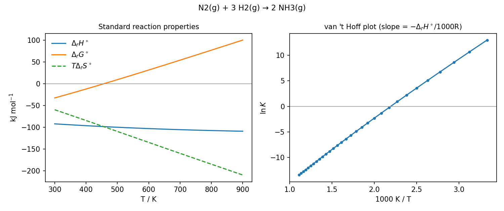

# thermo-reaction-tool

**`thermoreact`** is a reaction thermochemistry and equilibrium calculator for physical chemistry.
You type a reaction with ordinary chemical formulas, names or SMILES strings:

```
thermoreact reaction "N2 + 3 H2 -> 2 NH3" -T 298.15 500 700 --crossover
```

It looks up (or estimates) the standard enthalpy of formation ΔfH°, entropy S° and heat capacity Cp°
of every species, and computes the reaction enthalpy ΔrH°, entropy ΔrS°, Gibbs energy ΔrG° and
equilibrium constant K at any temperature:

```
Reaction: N2(g) + 3 H2(g) → 2 NH3(g)
Δn(gas) = -2   Cp treatment: full   standard state: 1 bar

   T/K   ΔrH°/kJ  ΔrS°/(J/K)  ΔrG°/kJ  ΔrCp°/(J/K)          K  log10 K
------  --------  ----------  -------  -----------  ---------  -------
298.15   -91.800    -198.110  -32.734      -44.341  5.428e+05    5.735
500.00   -99.711    -218.622    9.601      -33.299    0.09932   -1.003
700.00  -105.240    -228.028   54.380      -22.385  8.754e-05   -4.058

ΔrG° = 0 (K = 1) at: 455.8 K (182.6 °C)
```

I wrote it while taking CHM1402 (chemical thermodynamics) at the Université de Montréal, to check my problem sets faster than by hand. The tests still include the chemical-equilibrium exercises of that course, checked against the answer key. It is pure Python with no required dependencies, and I tried to keep every equation in the code easy to find.

## Project history

I wrote it in November 2022, without AI tools. Like my other projects, it stayed on my laptop (no version control) until I cleaned it up and published it here in November 2026, hence the single first commit. This README was rewritten with help from Claude, an AI assistant; the code is mine.

## Installation

Requires Python 3.8 or newer. The core has **no third-party dependencies** (standard library only).

Clone the repository, then:

```bash
cd thermo-reaction-tool
pip install .            # core
pip install ".[plot]"    # + matplotlib, for --plot
pip install ".[dev]"     # + pytest and matplotlib, for development
```

This installs the `thermoreact` command; `python -m thermoreact` works too.

## Quick start

```bash
# Combustion enthalpy of methane (liquid water as product)
thermoreact reaction "CH4 + 2 O2 -> CO2 + 2 H2O(l)"

# Let the tool balance the equation, and scan a temperature range
thermoreact reaction "C3H8 + O2 -> CO2 + H2O(g)" --balance --trange 300 1500 100

# Temperature at which limestone decomposes (K = 1), with a plot
thermoreact reaction "CaCO3 -> CaO + CO2" --crossover --trange 800 1300 25 --plot caco3.png

# A molecule given as SMILES (estimated if it is not in the database)
thermoreact reaction "smiles:CC(C)CC + O2 -> CO2 + H2O(l)" --balance

# Equilibrium composition of the Haber process at 700 K and 200 bar
thermoreact equilibrium "N2 + 3 H2 -> 2 NH3" --init N2=1,H2=3 -T 700 -P 200

# Properties of one substance at several temperatures
thermoreact species "H2O(g)" -T 298.15 500 1000
```

The `--plot` option draws ΔrH°, ΔrG° and TΔrS° versus T, next to the van 't Hoff plot (ln K vs 1/T):



## Writing reactions and species

**Arrows:** `->`, `=>`, `→`, `<=>`, `⇌`, or ` = ` (with spaces).
**Plus signs:** `CH4 + 2 O2` (spaces recommended; `CH4+2O2` also works for neutral species).
**Coefficients:** integers, fractions or decimals: `2 H2O`, `2H2O`, `1/2 O2`, `0.5 O2`.

**Species** can be written as:

| You type | Meaning |
|---|---|
| `H2O`, `water` | formula or name; when the phase is omitted, the stable phase at 298 K is used (here liquid) |
| `H2O(g)`, `H2O(l)`, `NaCl(s)`, `Cl-(aq)` | explicit phase: `g`, `l`, `s`, `aq` |
| `C(graphite)`, `C(diamond)`, `S(rhombic)` | named allotropes |
| `Ca(OH)2`, `CuSO4·5H2O` (also `CuSO4*5H2O`, `CuSO4.5H2O`) | groups and hydrates |
| `Cu2+`, `Cu^2+`, `Cu++`, `SO4^2-`, `NO3-` | ions (aqueous) |
| `smiles:CCO`, `smiles:CCO(g)` | a SMILES string, optionally with a phase |

If a formula matches several isomers (e.g. `C2H6O` is ethanol *and* dimethyl ether), the tool stops
and lists them, so you can write a name or a SMILES string. Unknown names get "did you mean"
suggestions. Run `thermoreact list` to see the 120+ species in the database, or
`thermoreact list oxide` to search it.

## Commands

| Command | What it does |
|---|---|
| `reaction` (`rxn`) | ΔrH°, ΔrS°, ΔrG°, ΔrCp°, K (and optionally Kc) at one or many temperatures |
| `species` (`sp`) | Cp°, S°, H°−H°₂₉₈, ΔfH°, ΔfG° of species versus temperature |
| `equilibrium` (`eq`) | equilibrium amounts from initial amounts, **or** K from a measured extent of reaction |
| `vanthoff` | integrated van 't Hoff equation: K₂, ΔrH° or T₂ from the other quantities |
| `electrochem` | K and ΔrG° from a standard cell potential E° (or E° from K) |
| `estimate` | Joback group-contribution estimate from a SMILES string, group by group |
| `list` | list or search the database |

Useful options (run `thermoreact <command> -h` for all of them):

| Option | Effect |
|---|---|
| `-T 298.15 500 …` | temperatures in K (default 298.15) |
| `--trange START STOP STEP` | a range of temperatures |
| `--celsius` | temperatures are given in °C |
| `--cp full\|constant\|none` | heat capacity: temperature-dependent (default), constant Cp(298 K), or ignored (ΔrH°, ΔrS° constant) |
| `--balance` | balance the equation automatically |
| `--crossover` | find the temperature(s) where ΔrG° = 0 (K = 1) |
| `--kc` | also print Kc (c° = 1 mol L⁻¹) |
| `--csv FILE`, `--json`, `--plot FILE.png` | export the results |
| `--data FILE.csv` | add your own species data (see below) |
| `--online` | look up unknown names on PubChem (needs internet) |

### Typical problem-set checks

```bash
# K from a degree of dissociation: N2O4 = 2 NO2, α = 0.201 at 298 K and 1 bar
thermoreact equilibrium "N2O4 -> 2 NO2" --init N2O4=1 --extent 0.201 -T 298.15
#   → K = 0.16841, ΔrG° = 4.416 kJ/mol

# K from an equilibrium composition with generic species
thermoreact equilibrium "A + B -> C + 2 D" --abstract --init A=2,B=1,D=3 --extent 0.79 -T 298
#   → K = 9.6047, ΔrG° = -5.605 kJ/mol

# van 't Hoff: K at 2000 K from K = 0.414 at 1600 K with ΔrH° = +112 kJ/mol
thermoreact vanthoff --K1 0.414 --T1 1600 --T2 2000 --dH 112          # → K2 = 2.2298

# Temperature where K reaches 1, from ΔrG°(1120 K) = +22 kJ/mol and ΔrH° = +125 kJ/mol
thermoreact vanthoff --dG1 22 --T1 1120 --K2 1 --dH 125              # → 1359.22 K

# Equilibrium constant from a cell potential
thermoreact electrochem --E0 0.48 --n 2                               # → K = 1.688e+16
```

More in [`examples/`](examples/).

## Using it from Python

```python
from thermoreact import Database, Reaction, solve_equilibrium

rxn = Reaction.from_string("CO + H2O(g) -> CO2 + H2")      # water-gas shift
p = rxn.properties(1000)                                   # T in kelvin
print(p.dH, p.dS, p.dG, p.K)                               # J/mol, J/(mol K), J/mol, dimensionless
# -34763  -31.76  -3008  1.436

rxn = Reaction.from_string("CaCO3 -> CaO + CO2")
print(rxn.crossover_temperature())                         # [1082.07...]

eq = solve_equilibrium(Reaction.from_string("N2 + 3 H2 -> 2 NH3"),
                       {"N2": 1, "H2": 3}, T=700, P_bar=200)
print(eq.mole_fractions()["NH3(g)"])                       # 0.299

db = Database.default()
print(db.formation(db.get("NH3"), 700)["dGf"])             # 27190 J/mol (JANAF: 27.190 kJ/mol)
```

All values inside the library are SI (J, J/K, K, bar for pressures). See
[`examples/python_api.py`](examples/python_api.py).

## How it works

### 1. From text to species

1. The reaction string is split at the arrow and at the `+` signs, and coefficients are read as exact
   fractions.
2. Each species is looked up in the database by id, formula, name, alias or Hill formula. A
   home-made **formula parser** handles brackets, hydrates and charges. A **SMILES parser**, also
   written from scratch so that RDKit is not needed, builds the molecular graph, adds implicit
   hydrogens and finds ring bonds (Tarjan's bridge algorithm).
3. A SMILES species is first compared with the SMILES stored in the database (matching atom
   environments, so ethanol and dimethyl ether are told apart). If it is not tabulated, its
   properties are **estimated** (step 3).
4. The tool checks that every element and the electric charge are conserved. With `--balance`, it
   finds the coefficients itself: the null space of the element-composition matrix, computed with
   exact rational arithmetic, scaled to the smallest whole numbers.

### 2. Standard thermodynamic relations

For a reaction Σ νᵢ Xᵢ = 0 (ν < 0 for reactants), each species carries ΔfH°(298.15 K), S°(298.15 K)
and a heat-capacity function Cp°(T). The tool then applies:

| Quantity | Relation |
|---|---|
| Enthalpy (Kirchhoff's law) | ΔrH°(T) = Σ νᵢ ΔfH°ᵢ(298.15 K) + ∫₂₉₈.₁₅ᵀ ΔrCp°(T′) dT′ |
| Entropy | ΔrS°(T) = Σ νᵢ S°ᵢ(298.15 K) + ∫₂₉₈.₁₅ᵀ ΔrCp°(T′)/T′ dT′ |
| Gibbs energy | ΔrG°(T) = ΔrH°(T) − T ΔrS°(T) |
| Equilibrium constant | K(T) = exp(−ΔrG°(T) / RT) |
| Concentration constant | Kc = K (P° / c°RT)^Δn(gas) |
| van 't Hoff (constant ΔrH°) | ln(K₂/K₁) = −(ΔrH°/R)(1/T₂ − 1/T₁) |
| Electrochemistry | ΔrG° = −nFE°, K = exp(nFE°/RT) |

The Cp integrals are done **analytically** for each heat-capacity segment. The standard state is
1 bar for gases, the pure substance for solids and liquids, and 1 mol kg⁻¹ for aqueous ions (with
the usual convention ΔfH° = ΔfG° = S° = 0 for H⁺(aq)). Constants are CODATA 2018
(R = 8.314462618 J mol⁻¹ K⁻¹).

The `--cp` option shows how much the heat-capacity correction matters:
- `full`: Cp(T) is used wherever it is available.
- `constant`: ΔrCp° is held at its 298 K value.
- `none`: ΔrH° and ΔrS° are held at their 298 K values, the usual first approximation in textbooks.

### 3. Heat capacities

- **NIST Shomate equations** (25 species, including H₂, O₂, N₂, H₂O, CO, CO₂, CH₄, NH₃, NOₓ, SO₂, SO₃, HCl,
  Cl₂, Br₂, C₂H₂, C₂H₄, O₃ and CaO): Cp = A + Bt + Ct² + Dt³ + E/t², with t = T/1000, valid up to
  6000 K for most gases.
- **Graphite:** the textbook form Cp = a + bT + c/T² (Atkins).
- **All other species:** constant Cp(298 K). The tool prints a warning when such a species is used more
  than 200 K away from 298 K.
- **Estimated species:** the Joback polynomial (≈ 273–1000 K).

Warnings are also printed when a phase is used outside its normal stability range, e.g. H₂O(l) above
373 K.

### 4. Estimating unknown molecules (Joback method)

For organic molecules given as SMILES that are not in the database, the molecule is cut into
functional groups (–CH₃, >C=O, –OH, aromatic =CH–, …) and the Joback–Reid group contributions are
summed:

- ΔfH°(298 K, gas) = 68.29 + Σ Nₖ ΔHₖ  (kJ/mol)
- ΔfG°(298 K, gas) = 53.88 + Σ Nₖ ΔGₖ  (kJ/mol)
- Cp°(T) = (Σa − 37.93) + (Σb + 0.210) T + (Σc − 3.91×10⁻⁴) T² + (Σd + 2.06×10⁻⁷) T³

S° then follows from ΔfS° = (ΔfH° − ΔfG°)/T and the entropies of the elements. Use
`thermoreact estimate "<SMILES>"` to see the groups and the result. If the molecule is also tabulated,
the command prints the error of the estimate. For acetone, for example, ΔfH° is off by −0.73 kJ/mol.

### 5. Equilibrium composition

For one reaction at temperature T and total pressure P, with ideal gases and pure condensed phases
(activity 1), the reaction quotient is

  Q(ξ) = Π_gas (xᵢ P/P°)^νᵢ,   with nᵢ(ξ) = nᵢ,₀ + νᵢ ξ,

and the equilibrium extent ξ solves ln Q(ξ) = ln K. Since ln Q increases monotonically with ξ, the
solution is found by bisection between the bounds set by the initial amounts. The solver also covers:
- an inert diluent gas (`--inert`);
- a solid reactant that is used up before equilibrium is reached;
- the special case where Q does not depend on ξ, e.g. CaCO₃(s) ⇌ CaO(s) + CO₂(g).

The inverse problem (`--extent`) computes K from a measured composition.

## Data sources

The bundled data live in [`src/thermoreact/data/`](src/thermoreact/data/):

- **`species_298.csv`**: 123 species (gases, liquids, solids, aqueous ions), with ΔfH°, S° and
  Cp° at 298.15 K and 1 bar. Each row names its source:
  - **NIST**: NIST Chemistry WebBook / NIST-JANAF Thermochemical Tables (Chase, 1998) and CODATA
    Key Values (Cox, Wagman & Medvedev, 1989).
  - **NBS**: NBS Tables of Chemical Thermodynamic Properties (Wagman *et al.*, 1982), the source of
    the data tables in Atkins' *Physical Chemistry*.
- **`shomate.json`**: Shomate coefficients from the NIST Chemistry WebBook.
- **Joback groups**: K. G. Joback & R. C. Reid, *Chem. Eng. Commun.* **57**, 233 (1987). The group
  table was checked value by value against the open-source `thermo` package.

The 298 K table was cross-checked against the independent compilation in the `chemicals` Python
package: about 90 % of the entries it covers agree within 1 kJ/mol and 1 J/(mol K). The rest are known differences
between data sources (e.g. ATcT vs JANAF for acetylene).

## Accuracy and validation

The test suite has 247 tests. Highlights:

- **Data integrity.** Every Shomate fit reproduces H − H₂₉₈ = 0 and the tabulated S° and Cp° at
  298.15 K. Neighbouring temperature segments join continuously. The integrated H(T) and S(T) match
  NIST's own values.
- **Reference values.** ΔfG° at 298 K is checked for 15 species, including ions (within 0.35 kJ/mol).
  NIST-JANAF ΔfG° at 500–1500 K is checked for NH₃, H₂O, NO and HCl (within 0.15 kJ/mol). Also
  checked:
  - combustion of methane (−890.3 kJ/mol);
  - Haber–Bosch at 298 K and 700 K;
  - water-gas shift at 1000 K (K = 1.44);
  - Ksp(AgCl) = 1.8 × 10⁻¹⁰;
  - the boiling point of water from ΔvapG° = 0 (372.8 K at 1 bar).
- **Thermodynamic consistency.** Numerical derivatives confirm d(ΔrH°)/dT = ΔrCp° and the
  Gibbs–Helmholtz equation.
- **Course problems.** The CHM1402 *Série 5 – Équilibres chimiques* exercises 3, 5 and 8–14 match the
  answer key (N₂O₄ dissociation, K from composition, Br₂ dissociation with van 't Hoff, crossover
  temperatures, CuSO₄·5H₂O dehydration at 398 K, electrochemical K and Ksp). One test documents that
  the key's K = 0.414 for Br₂ only comes out if the pressure is read as 1.67 atm rather than 1.67 bar.
- **Joback.** Group assignment is tested for 20 molecules, and ΔfH° for 12 molecules is within
  3–4 kJ/mol of experiment.

## Limitations

Everything is ideal: ideal gases, pure condensed phases and ideal 1 mol kg⁻¹ aqueous standard states, with no fugacity or activity coefficients.

The equilibrium solver handles one reaction at a time (no simultaneous equilibria, no free-energy minimisation) and leaves aqueous species out, even though K is computed for them. Phase changes are not followed automatically either: you choose the phase, and the tool warns you when you use it outside its usual range.

Species without a Cp(T) fit use a constant Cp(298 K), which gets less accurate far from 298 K (ions always keep their 298 K values).

Joback estimates are for ideal gases only. The error is usually a few kJ/mol, but it can be much larger for small or strained molecules (cyclohexane is off by about +31 kJ/mol) and for some ethers (dimethyl ether, about −33 kJ/mol). The method doesn't cover inorganic or charged species, or groups such as S=O.

Finally, `--online` only turns a name into a SMILES string through PubChem; the thermochemical data still come from the bundled tables or from the Joback estimate.

## Adding your own data

Put extra species in a CSV file with at least the columns `formula, phase, dHf_kJ, S_J`.
Optional columns: `Cp_J, name, aliases, id, std, cas, smiles, tmin, tmax, source`. Then:

```bash
thermoreact reaction "PbS + O2 -> PbO + SO2" --balance --data examples/my_species.csv
```

See [`examples/my_species.csv`](examples/my_species.csv). From Python: `db = Database.default().copy();
db.load_csv("my_species.csv")`. To add a temperature-dependent Cp to the bundled data, add the
Shomate coefficients to `shomate.json`. The tests check them automatically.

## Project layout

```
src/thermoreact/
  cli.py            command-line interface (argparse)
  reaction.py       reaction parsing, balancing, ΔrH°/ΔrS°/ΔrG°/K(T), crossover temperature
  equilibrium.py    equilibrium extent solver, K from a measured extent
  relations.py      van 't Hoff, ΔG = −RT ln K, ΔG = −nFE, Kc, degree of dissociation
  species.py        Species: H(T), S(T), G(T), Cp(T), validity warnings
  database.py       loading data files, lookup by formula/name/SMILES, formation properties
  heat_capacity.py  Shomate, polynomial and constant Cp models with exact integrals
  formula.py        chemical formula parser, Hill formulas, molar masses
  smiles.py         SMILES parser (no RDKit needed)
  joback.py         Joback group assignment and estimates
  online.py         optional PubChem name → SMILES lookup (standard library only)
  plotting.py       matplotlib figures
  data/             species_298.csv, shomate.json
tests/              pytest suite (247 tests)
examples/           Python and shell examples, sample user data file
```

## Development

```bash
pip install -e ".[dev]"
pytest                                            # full suite
python -m pytest --doctest-modules --pyargs thermoreact   # docstring examples
```

The suite passes on Python 3.8, 3.9, 3.10 and 3.11. GitHub Actions runs it on every push for
Python 3.10 and 3.11 (`.github/workflows/tests.yml`; GitHub's current runners no longer provide 3.8).
Things I'd like to add: a small web front end, NASA 7-coefficient polynomials, phase transitions
inside Kirchhoff integrals, Benson group additivity, multi-reaction Gibbs minimisation.

## License

MIT. See [LICENSE](LICENSE).
